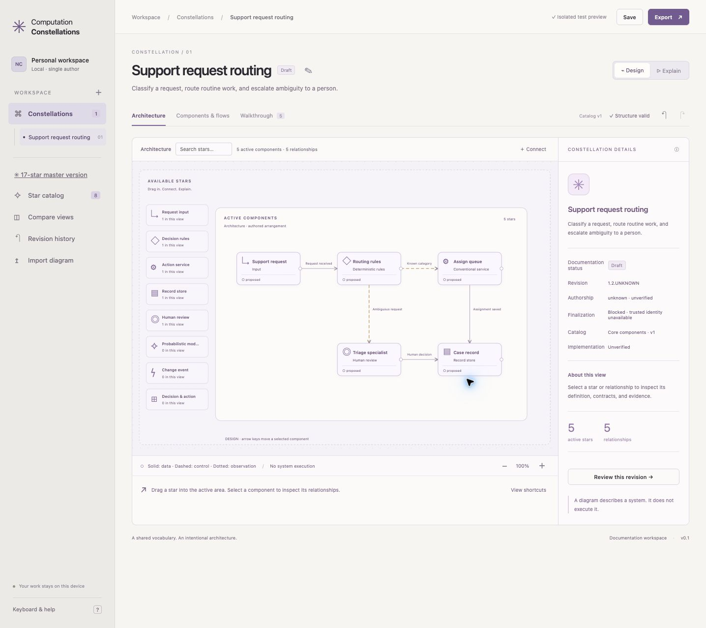
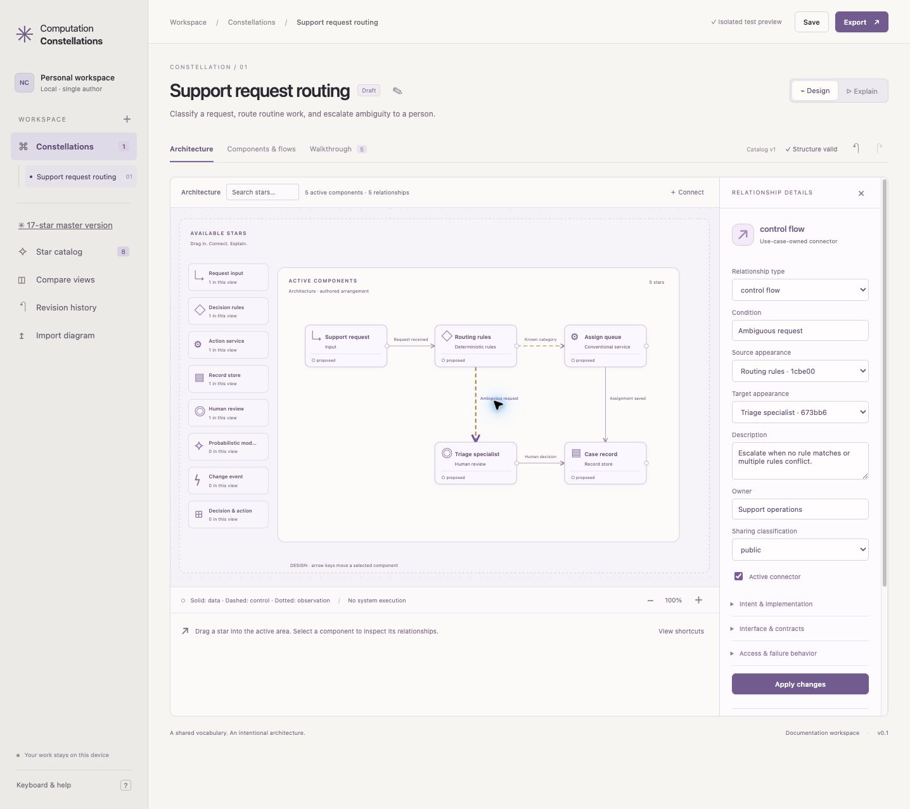
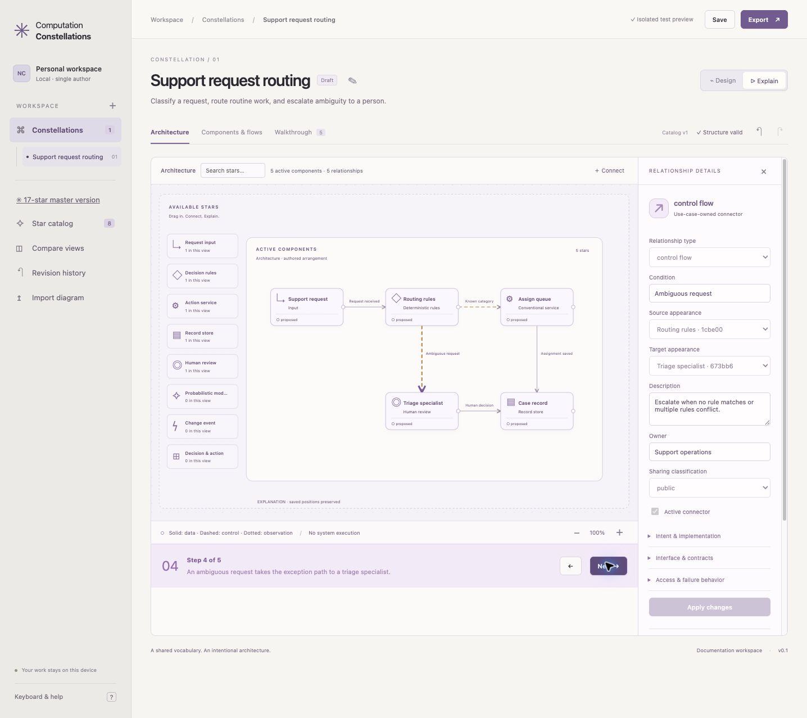
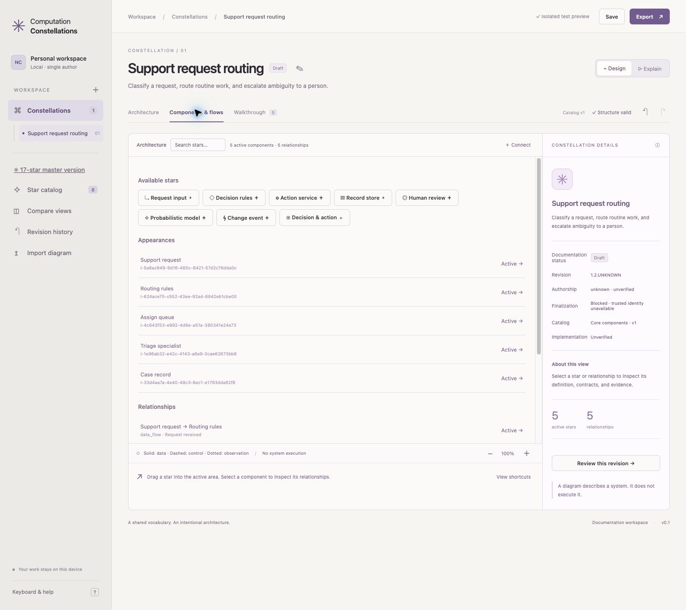

# Visual tour: support request routing

This synthetic constellation describes a support request moving through explicit routing rules. Routine requests go to a queue; ambiguous requests go to a triage specialist. Both routes end in a case record. It contains five components, five relationships, and five walkthrough steps. No service runs or receives real requests.

## 1. Read the architecture

Read left to right: **Support request → Routing rules → Assign queue**. The lower branch takes ambiguity to a **Triage specialist**. Both outcomes reach **Case record**. Solid lines describe data flow; dashed lines describe control flow. Available stars remain outside the active area, ready to reuse. The inspector summarizes this draft and its unverified implementation status.

## 2. Inspect the exception path

Select the **Ambiguous request** connector (or focus it and press Enter). The inspector identifies its control-flow type, source, destination, condition, description, and example owner. This relationship escalates when no rule matches or multiple rules conflict. Expand **Interface & contracts** or **Access & failure behavior** to inspect the included handoff contract and pending-request fallback.

## 3. Explain the decision

Choose **Explain → Begin walkthrough**, then advance to step four. The exception path is highlighted while the authored layout stays in place. The explanation bar describes why the request goes to a specialist; the inspector shows the selected relationship with editing disabled.

## 4. Browse components as a list

**Components & flows** provides a text-based alternative to the canvas. It lists reusable stars, individual appearances with stable identifiers, and relationships further down the scrollable pane. Select an entry to inspect it.

## Open the example yourself

1. Download [support-request-routing.drawio](examples/support-request-routing.drawio) using GitHub's **Download raw file** control, or use the copy in your checkout.
2. Run `npm start` from the project directory.
3. Open `http://127.0.0.1:4173/tests/preview` for an isolated, temporary workspace that does not overwrite your browser save. Reloading this preview resets it.
4. Choose **Import diagram**, select the file, review the preview, and choose **Accept import**. It should report one use case, eight catalog stars, and zero structural errors.
5. Explore **Architecture**, **Explain**, and **Components & flows**. To retain edits from the temporary preview, use **Export** with the private audience so labels, descriptions, and walkthroughs are preserved.

You can also import into the normal browser or desktop workspace. Import replaces that workspace, so export your existing work first.

The file is an agent-authored documentation example containing only synthetic data. It intentionally retains descriptive metadata for this public tutorial. An imported copy opens as a new draft with unknown authorship; the version label therefore differs from the source file. Screenshots were captured from the actual browser interface on November 24, 2026, in isolated preview mode. The imported file passed structural validation, and the displayed walkthrough was exercised through the UI. No external draw.io Desktop compatibility or implemented support system is claimed.
